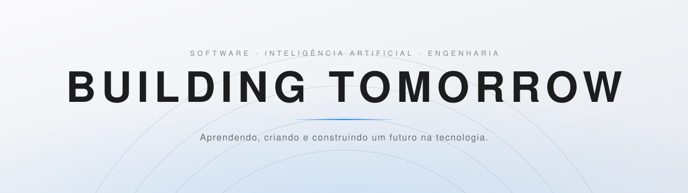

<picture>
  <source media="(prefers-color-scheme: dark)" srcset="./assets/banner-dark.svg">
  <source media="(prefers-color-scheme: light)" srcset="./assets/banner-light.svg">
  
</picture>

 

<!-- ✏️ TROQUE "SEU NOME" PELO SEU NOME -->
# KAUÃ DIAS GUIMARÃES PEREIRA

**Futuro engenheiro de software.** 
Estudante de Informática para Internet, construindo uma base sólida 
para uma carreira internacional em tecnologia.

 

 

### SOBRE MIM

 

Sou estudante de um curso técnico integrado de **Informática para Internet**. 
Me interesso por desenvolvimento de software, inteligência artificial 
e pela forma como tecnologia e design podem se encontrar em bons produtos.  
Gosto de design minimalista, de interfaces limpas e de detalhes bem pensados. 
Meu objetivo é aprender com consistência e construir uma carreira 
com alcance internacional.

 

 

### FOCO ATUAL

 

<table align="center">
  <tr>
    <td align="center" width="33%" valign="top">
       
      <strong>Desenvolvimento de Software</strong>
        
      Aprender a pensar, escrever e organizar código com clareza.
        
    </td>
    <td align="center" width="33%" valign="top">
       
      <strong>Inteligência Artificial</strong>
        
      Entender os fundamentos e explorar como a IA transforma produtos.
        
    </td>
    <td align="center" width="33%" valign="top">
       
      <strong>Engenharia de Software</strong>
        
      Estudar boas práticas, arquitetura e a construção de sistemas.
        
    </td>
  </tr>
</table>

 

 

### TECNOLOGIAS QUE ESTOU APRENDENDO

 

<code>HTML</code> &nbsp; <code>CSS</code> &nbsp; <code>JavaScript</code> &nbsp; <code>Figma</code>

Lista em construção. Aprender é um processo contínuo.

 

 

### PROJETOS

 

<!--
  ✏️ PARA CADA PROJETO REAL:
  1) Troque o título, a descrição e o link.
  2) Se ainda não tiver projetos, deixe como está (indica "em breve").
-->

<table align="center">
  <tr>
    <td align="center" width="50%" valign="top">
       
      <strong>Site do corretor</strong>
        
      Site institucional e portfólio profissional para o corretor Fernando Silveira.
        
      <code>https://github.com/kauaguimapereira-bit/site-corretor.git</code>
        
    </td>
    <td align="center" width="50%" valign="top">
       
      <strong>Site da doutora</strong>
        
      Site institucional e portfólio profissional para Dra. Lilian Guimarães, Farmacêutica Esteta, com foco em estética facial e corporal.
        
      <code>https://github.com/kauaguimapereira-bit/site-dra-lilian.git</code>
        
    </td>
  </tr>
</table>

 

 

### OBJETIVOS

 

**Construir uma base sólida em Engenharia de Software** 
Fundamentos, boas práticas e código bem feito.

 

**Explorar a Inteligência Artificial** 
Aprender como ela funciona e como aplicá-la de forma útil e responsável.

 

**Criar projetos com bom design e propósito** 
Tecnologia que funciona bem e tem boa aparência.

 

**Construir uma carreira internacional em tecnologia** 
Me preparar hoje para oportunidades além das fronteiras.

 

 

### CONTATO

 

<!--
  ✏️ SUBSTITUA CADA "COLE-AQUI..." PELO SEU LINK REAL.
  Apague os itens que você não for usar.
-->

<a href="https://www.linkedin.com/in/kauã-dias-guimarães-pereira-2abb0a321 ">LinkedIn</a>
&nbsp;&nbsp;·&nbsp;&nbsp;
<a href="mailto:kauaguimapereira@gmail.com">E-mail</a>
&nbsp;&nbsp;·&nbsp;&nbsp;
<a href="http://lattes.cnpq.br/1153458848292114">Portfólio</a>

 

 

<i>Building tomorrow, one step at a time.</i>

